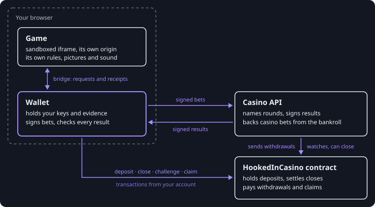

HookedIn keeps a running balance between you and the casino in a **channel**. The contract holds what you deposit, every
bet is a pair of signed messages that moves the balance, and the chain is needed only to deposit, to pay withdrawals and
to close.



The game runs in a sandboxed frame beside the wallet and asks it for bets over a message bridge. The wallet signs each
bet and sends it to the casino, which answers with a signed result. The wallet sends deposits, closes, challenges and
claims to the contract from your account; the casino sends it each withdrawal to pay, and can close a channel too.

## Channels

A channel belongs to an **account**, an Ethereum key the wallet keeps, whose address is your **deposit address**. An
account plays on one channel at a time, numbered by how many of its channels have started closing, and each is active
from the start: there is nothing to open, and no permission to ask.

**Deposit.** `deposit(player)` adds money to the account's channel, from anyone. The contract holds every deposit as the
channel's **principal**, which the casino cannot withdraw. The balance takes it in with a **deposit** operation once the
casino has seen the money confirmed; until then a close adds it to what the channel is owed.

**Sign.** Every change to the balance is an **operation** the account signs, answered by a **checkpoint** the casino
signs: the channel, a sequence number, the hash of the state before, a hash of the operation, the balance after it, and
how much the balance has taken in of the channel's deposits and paid out in withdrawals and lock-ins. The wallet
re-derives the checkpoint, checks the casino's signature, countersigns it and saves it before the game hears anything.
The contract knows six kinds of operation:

| Kind         | Effect on the balance       | Used for                                                                                                                        |
| ------------ | --------------------------- | ------------------------------------------------------------------------------------------------------------------------------- |
| 1 casino bet | − stake, + prize if it wins | Casino bets                                                                                                                     |
| 2 debit      | − amount                    | Payments, developer bets, investing in the bankroll fund, deposits into a game's bank, transfers                                |
| 3 credit     | + amount                    | Collecting what is owed: developer bet payouts, sold shares, withdrawals from a game's bank, transfers, a deposit's network fee |
| 4 deposit    | + amount                    | Taking in money deposited into the channel                                                                                      |
| 5 withdrawal | − amount − fee              | Withdrawals, which the contract pays to the address the operation names                                                         |
| 6 lock-in    | − amount − fee              | Lock-ins, which the contract pays into the account's own channel as deposits                                                    |

What an operation means, which game asked for it and what it pays into or collects from, is in its **details**, whose
hash it signs. The contract never reads them; the wallet and the casino check and keep them ([signed
messages](../reference/signed-messages.md)).

**Principal, collateral and winnings.** Withdrawals and a close are paid first out of the channel's principal, then out
of its **collateral**, house cash locked into the channel by an offer anyone buys on-chain or by a dispute. What the
balance holds above both, its **winnings**, is owed from the shared bankroll until the contract pays it, or until you
[lock it in](../wallet/closing-and-claims.md#lock-in-your-balance).

## Rounds

Every casino bet is settled by a **round**, and neither side can choose its outcome:

1. The casino picks a random **secret** and names the round by its hash, `round = keccak256(secret)`, in its quote.
2. The wallet signs a bet that names that round and the hash of a random **seed** of its own,
   `seedHash = keccak256(seed)`, and sends the seed with it. The casino fixed its secret before it could see the seed.
3. The casino's result reveals the secret. The wallet checks both preimages against the hashes the bet signed, and works
   out the **outcome**:

```text
outcome = low 64 bits of keccak256(abi.encode(keccak256("HOOKEDIN/OUTCOME"), seed, secret))
```

A round settles one casino bet. A declined bet reveals nothing, and its round takes the channel's next bet.

## Quotes

Every reply brings the casino's **quote** for the channel's next casino bet: the round it settles on, the **virtual
bankroll** it is admitted against, half the casino's bankroll when it quoted, and an expiry a day away. A quote
**covers** a bet that names its checkpoint and round before it expires, and whose terms its virtual bankroll admits by
the casino's [Kelly rule](../reference/economics.md#a-casino-bet-is-one-wager).

The casino must settle every bet a quote covers, and the wallet sends the seed only with a covered bet, so the casino
declines any other without learning what it would have paid. A covered bet the casino leaves unsettled, the wallet or a
watchtower **disputes** before the quote expires, closing the channel with it: the contract counts it as won until the
casino settles it with the round's secret ([dispute a casino
bet](../wallet/closing-and-claims.md#dispute-a-casino-bet)). A quote binds the casino for its day whatever the bankroll
does meanwhile, so the bankroll [overcommits](architecture.md#limitations).

## Casino bets

A casino bet is three numbers: a **stake** paid to enter, a **chance** and a **prize**. It wins when the round's outcome
is below its chance, which counts the winning outcomes out of 2^64, and a win pays the prize. One signed bet is one
wager with two outcomes: a coin flip, a roll of the dice, one tile of Mines. A coin flip that pays 1.96 times the stake:

| Term            | Value                                              |
| --------------- | -------------------------------------------------- |
| Stake           | 1,000 METH (`1000000000000000` wei)                |
| Chance          | 2^63 (`9223372036854775808`) of 2^64 outcomes: 50% |
| Prize           | 1,960 METH (`1960000000000000` wei)                |
| Expected payout | 980 METH                                           |
| House edge      | 20 METH, 2% of the stake                           |

The wallet works out every bet's expected payout before signing it and shows its [house
edge](../wallet/bets-and-receipts.md#house-edge). A game of more outcomes plays them as bets like this one: the wallet
[collapses](../games/collapsing-bets.md) each step of a game such as Plinko into one bet it draws, and a game whose
players share one draw, such as roulette, is backed in [binary
steps](../games/developer-bets.md#shared-games-binary-steps).

A casino bet settles against the casino's bankroll in the request that places it. One its quote does not cover, the
casino declines with a **rejection**, a signed checkpoint that leaves the balance unchanged. A game can also charge a
**payment**, a fixed debit to the bankroll for a charge that does not depend on chance, which settles on no round and
earns no commission.

## Developer bets

A developer bet is against the game's developer instead of the bankroll: a debit whose details carry `meta`, the game's
own JSON saying what the bet is. Its stake goes into the game's **bank** at the casino at once, and the game's server
settles it later with a `Settlement`, signed by the key its developer named, which the wallet checks and collects. It
has no odds and no house edge, and only a published game takes one ([trust
model](trust-model.md#developer-bets-trust-their-developer)).

## The bankroll and commission

The casino's **bankroll** backs every casino bet. The casino admits a bet only when its quote's virtual bankroll could
take it with no commission at all, by the exact Kelly condition for its two outcomes. Its **commission** is then the
edge that virtual bankroll does not need, split equally between the game's bank and the casino: the casino's accounting,
never a second debit from your balance ([economics](../reference/economics.md),
[earnings](../games/publishing.md#earnings)). Anyone with a balance can invest in the bankroll through the [bankroll
fund](../wallet/bankroll-fund.md).

## Withdrawing

A withdrawal takes part or all of the balance out while the channel stays active: an operation naming the address to
pay, which the casino signs at once and sends to the contract, for a fee; anyone else may send it too. The contract pays
it out of the channel's principal first, then its collateral, and its winnings from house cash
([withdraw](../wallet/closing-and-claims.md#withdraw)). To fund a friend's balance,
[transfer](../wallet/getting-started.md#transfer) to them instead, off-chain and with no fee.

## Closing and claims

Only a close ends a channel, and either side can start one alone with its latest
[evidence](../reference/signed-messages.md#evidence). The account moves to its next channel at once, and a 7-day window
opens, in which anyone with strictly newer evidence can replace the close's state. After it, anyone can finalize, which
records what the close is owed as a **claim**: protected up to the channel's principal and collateral, and the rest
winnings, paid first in, first out as house cash arrives and the [payout
limit](../reference/contract.md#the-payout-limit) allows. [Closing and claims](../wallet/closing-and-claims.md) walks
through each step.
